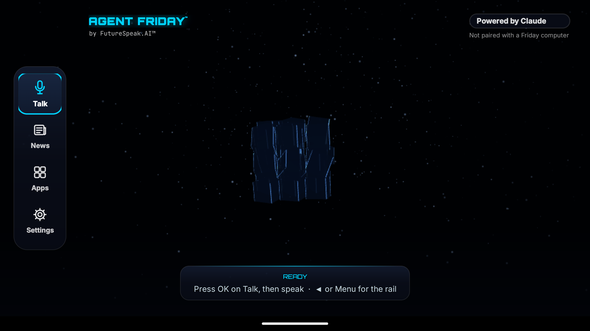

# Agent Friday™ for TV

**Put Agent Friday on your Android TV or Google TV, from your PC, in about ten minutes.**

Agent Friday for TV is a TV app you talk to with your remote: hold OK, ask a question, and Friday answers out loud, with full-screen cards when a picture or a table helps. It has a family mode with a grown-up PIN, and add-ons such as Friday News. This repository holds the TV app, its helper, the add-on contract, and a setup wizard. The wizard finds your TV on your network, walks you through the remote presses, and installs everything for you.

It works on its own, or as an extension of [Agent Friday desktop](https://github.com/FutureSpeakAI/Agent-Friday), where Friday walks you through it herself.



*Screenshot from the Android emulator, with no account or household data.*

## What's in here

| Piece | What it does |
|---|---|
| **Agent Friday** (`android/tv`) | Friday on the TV: voice from the remote, spoken answers, cards, channels, family mode, the grown-up PIN and Studio. |
| **Ad Break Guard** (`android/helper`) | A small helper with no internet access. It mutes and covers ad breaks that apps label on screen ("Ad 1 of 2"), keeps the shared grown-up PIN, kids' screen time and bedtime, and keeps the Cast receiver awake. |
| **Add-on SDK and contract v1** (`android/addon-sdk`, [docs/ADDON-CONTRACT.md](docs/ADDON-CONTRACT.md)) | How other apps plug into Friday on the TV: her look, her voice, her approval card, her receipts and kids mode. |
| **Setup wizard** (`wizard/`, `setup.ps1`, `setup.sh`) | Finds the TV, pairs, installs, adds your keys, offers optional privacy hardening, verifies, and undoes it all. |
| **Friday desktop extension** (`extensions/friday-desktop`) | The same wizard as tools Friday desktop can use, with her approval card before each change. |

Optional add-ons, in their own repositories:
- **[Friday News](https://github.com/FutureSpeakAI/friday-tv-news):** headlines from public outlets, read aloud, with a kids filter and your local weather.
- **Wonder Owl:** a kid-safe explorer with a story mode. Coming soon.

## What you need

- An **Android TV or Google TV** running Android 11 or later. Sony, TCL, Hisense, Philips, Chromecast with Google TV, onn and others all qualify. Android 9 and 10 work too, with network debugging.
- A **PC** (Windows, macOS or Linux) on the same network, with **Python 3.9 or later**.
- Your own **Claude API key** from [console.anthropic.com](https://console.anthropic.com/settings/keys). Usage is billed to you by Anthropic.
- Optional keys: ElevenLabs (Friday's voice, story voices, sounds, music), kie.ai (pictures), OpenRouter, Gemini, Firecrawl. Each one is optional; see [Bring your own keys and models](#bring-your-own-keys-and-models).
- For **v0.1.0**: Java 17 and the Android SDK, to build the APKs once (see [Build from source](#build-from-source)). Signed downloadable APKs will come with a later release.

## Quick start (about 10 minutes)

1. Download this repository (green **Code** button > Download ZIP) and unzip it, or `git clone` it.
2. Run the wizard:
   - **Windows:** right-click `setup.ps1` > *Run with PowerShell*.
   - **macOS / Linux:** `./setup.sh`
3. Follow along with the remote. The wizard tells you each press:
   1. **Find your TV.** It lists the Android TVs it can see. Pick yours.
   2. **Developer options.** *Settings > System > About*, then press OK on *Android TV OS build* seven times.
   3. **Pairing.** *Settings > System > Developer options > Wireless debugging > On > Pair device with pairing code*. Type the six digits into the wizard.
   4. **Install.** Agent Friday and its helper, plus Friday News if you want it.
   5. **Keys.** Paste your keys at hidden prompts. They go straight to your TV. Optionally, add Friday's own offline speech recognizer.
   6. **Optional hardening.** A checklist. Every item is off unless you say yes, and each has a one-line undo.
   7. **Check.** The wizard confirms what's on the TV.
4. On the TV, open **Apps > Agent Friday**. Hold **OK** on *Talk* and ask something.

**With Friday desktop:** add the extension ([extensions/friday-desktop](extensions/friday-desktop/README.md)), then say *"Friday, set up Friday on my TV."*

## Bring your own keys and models

You choose which AI service does each job, with your own keys. Anything without a key falls back to something that still works:

| Job | Default | Without its key |
|---|---|---|
| Answers and stories | Claude (`claude-opus-5-5`), or OpenRouter | Friday asks a grown-up to add a key |
| Friday's voice and story voices | ElevenLabs | The TV's own voice |
| Sound effects and music | ElevenLabs | None |
| Pictures and short clips | kie.ai (`nano-banana-2`; clips off by default) | Still pictures |

Pick models and voices during the Keys step, or give the wizard a small file with no keys in it (`--providers`, see [providers.example.json](providers.example.json)). Details: [docs/PROVIDERS.md](docs/PROVIDERS.md).

## Undo

- **Undo the hardening:** `setup.ps1 undo --device <ip:port>`. Or run each item's one-line undo, for example `adb shell pm enable --user 0 com.tcl.ttvs`.
- **Remove everything:** `setup.ps1 uninstall --device <ip:port>` undoes the hardening, removes your keys from the TV, switches the helper off, and uninstalls the apps. Afterwards, switch *Wireless debugging* off again on the TV.
- **On the TV alone:** *Settings > Apps > Agent Friday > Uninstall* removes the app, your keys, history and channels.

## Privacy

- **No telemetry.** None of these apps or scripts report anything to us or to anyone else. The TV apps have no analytics or third-party SDKs; tests enforce that.
- **Your keys stay on your devices.** You type them on your PC. They go over your local network to your TV, where the Android Keystore seals them, and to the provider that issued them. They are never shown, logged, written to disk in the clear, or put on a command line. Add-ons never receive keys.
- **What leaves the TV:** your questions go to the AI provider you chose. Friday News fetches public news feeds. If you set a town, Open-Meteo gets that town's coordinates for the weather.
- **The helper has no internet permission at all.**

## Third-party AI services

Friday's answers come from AI services you connect with your own keys: Anthropic (Claude), and optionally ElevenLabs, OpenRouter, Google (Gemini), Firecrawl and kie.ai. Each has its own terms of service, usage policies, privacy policy and prices, and **you agree to those with each provider directly**. FutureSpeak.AI isn't a party to them and doesn't see your usage. AI answers can be wrong; check anything important.

## Optional apps we suggest but don't ship

We don't bundle or redistribute anyone else's app. If you want them, install them from their official sources:
- [SmartTube](https://github.com/yuliskov/SmartTube): an ad-free YouTube client for Android TV.
- [Projectivy Launcher](https://play.google.com/store/apps/details?id=com.spocky.projengmenu): a home screen without sponsored rows.

## Privacy hardening, and what it never touches

Hardening is optional and off by default. The generic profile works on any Google TV. The optional vendor profiles, such as TCL's, appear only when your TV reports that maker. Some things are never changed, whatever a profile says: Google's launcher, the Cast receiver, Google Play services, the Play Store, system updates, HDMI-CEC, inputs and the remote. After every batch the wizard checks that your TV still shows up for Cast, and rolls the batch back if it doesn't. Details: [docs/NEVER-BREAK.md](docs/NEVER-BREAK.md).

## Troubleshooting

- **"No TV answered."** Check that the TV is on and on the same network as the PC. Some routers keep Wi-Fi and wired devices apart, or isolate guest networks. Type the TV's IP address when asked (TV: *Settings > Network & Internet >* your network). VPNs can also hide the TV.
- **Pairing fails.** The code changes every time the pairing screen opens. Keep the screen open and type the code it shows now.
- **"Couldn't connect" later.** Wireless debugging switches itself off when the TV restarts. Turn it on again; no new pairing is needed.
- **`INSTALL_FAILED_UPDATE_INCOMPATIBLE`.** A copy signed on another computer is already installed. Uninstall it first; this deletes its data.
- **The build fails.** Check that Java 17 is installed (`java -version`) and the Android SDK is found (set `ANDROID_HOME`, or create `android/local.properties` with `sdk.dir=`).
- **Friday doesn't hear you.** On first use, Android asks for the microphone; choose *Allow*. Some remotes need a long press on OK.
- **Cast disappeared after hardening.** Run `setup.ps1 undo --device <ip:port>`, then see [docs/NEVER-BREAK.md](docs/NEVER-BREAK.md).

## FAQ

**Is this an official Google or TV-maker app?** No. It's an independent open-source project by FutureSpeak.AI.

**Does it root the TV or void the warranty?** No. It uses Android's own developer setting to install apps, the same way developers do. Nothing is rooted or flashed, and a factory reset removes everything.

**Do I need Friday desktop?** No. The TV app runs with just your keys. Friday desktop can run the setup for you, and pairing the TV with Friday desktop (so it can use your desktop Friday) is in early testing.

**What does it cost?** The apps are free (MIT). AI usage is billed to you by the providers you choose.

**Can I write an add-on?** Yes. See [docs/ADDON-CONTRACT.md](docs/ADDON-CONTRACT.md); Friday News is a complete example.

**Does it work on Fire TV?** Not in v0.1. Fire TV's discovery and settings differ, so it's untested there.

## Build from source

You need Java 17 and the Android SDK (Android Studio installs both). Then:

```bash
cd android
./gradlew testReleaseUnitTest assembleRelease
```

The APKs land in `android/tv/build/outputs/apk/release/` and `android/helper/build/outputs/apk/release/`. Without a keystore, they're signed with your computer's Android debug key; that's fine for your own TV. For your own release key, see [android/signing.gradle](android/signing.gradle). Never commit a keystore. The wizard finds these builds by itself, or you can point it at them with `--apk-dir`.

Wizard tests: `python -m unittest discover -s wizard/tests`

## Contributing, security, license

- [CONTRIBUTING.md](CONTRIBUTING.md) explains how to propose changes. Bug reports are welcome.
- [SECURITY.md](SECURITY.md) explains how to report a vulnerability privately.
- License: [MIT](LICENSE), Copyright (c) 2026 FutureSpeak.AI. Third-party parts and their licenses: [THIRD_PARTY_NOTICES.md](THIRD_PARTY_NOTICES.md).

Agent Friday™ and FutureSpeak.AI™ are trademarks of FutureSpeak.AI. The MIT license covers the code, not the names or logos. Android, Google TV and Google Cast are trademarks of Google LLC. Other product names belong to their owners.
